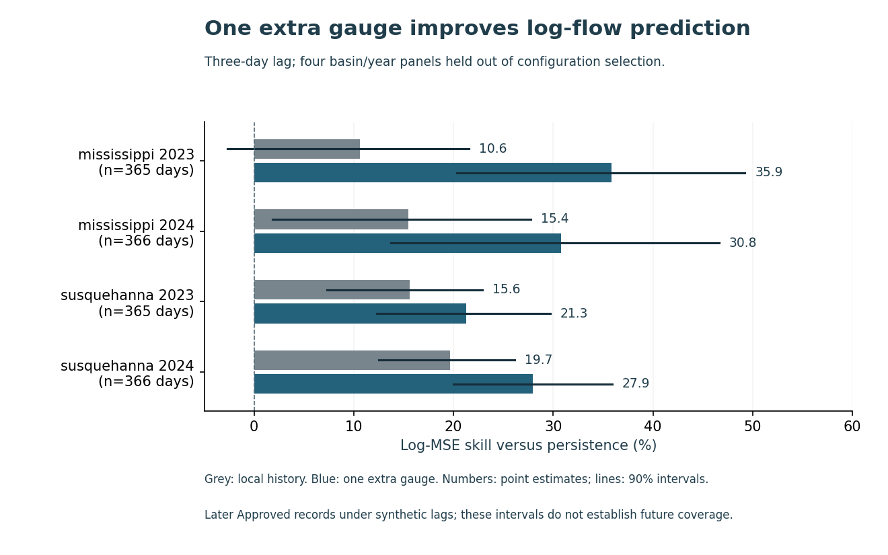

# Test what a second river gauge adds before changing monitoring

A second data feed is useful only if it improves the error that matters to the decision. This retrospective exercise tests target-gauge history against the same history plus one additional gauge, with fixed date lags and a synthetic outage.

**Finding on the declared log-flow objective:** across four final basin/year panels, equal-panel mean skill versus persistence is **28.96% for the pair model and 15.32% for local history**. The difference is **13.64 percentage points of persistence-normalized log MSE**. The pair model has lower log MSE in each primary panel.

**The physical error scale can reverse the comparison.** For Susquehanna 2023, pair-model MSE in cubic-feet-per-second units is **416.16 million cfs squared**, versus **403.45 million** for local history. The transformed-scale finding is not a win on every loss. Keep the decision-relevant objective visible before selecting a model or funding a monitoring change.

Use this result to justify a prospective source-availability and error-cost pilot for the specific gauge pair. No gauge purchase, network optimum, flood-warning lead time, safety benefit or saving was measured.

Read the [six-page independent study](paper/manuscript.pdf), [complete final comparison](FINAL_NOTE_V2.md), or [all model-panel metrics](results/v2/final/panel_metrics.json). The manuscript is not peer reviewed.

## The original failure stays visible

The original 2020–2025 study failed its fixed 95% Approved-day gate in three 2025 station-years. Its [protocol](PROTOCOL.md), [source hold](SOURCE_HOLD.md) and [failed receipt](results/SOURCE_FAILURE.json) remain unchanged. It is not counted as a successful experiment.

[Version 2](PROTOCOL_V2.md) was specified and committed before any recorded-data model fit. It uses the same eight gauges and 95% Approved-day threshold over 2020–2024, informed by the existing source-approval ledger. All source values were already present; the new period is an approval-informed retrospective choice, not a blinded collection or external preregistration. V2 does not certify that v1 passed.

Train on 2020–2021; select penalties using Wisconsin/Delaware validation in 2022; evaluate 2023–2024 in Susquehanna/Mississippi, retaining the development basins' later results as context. Held basins fit their own earlier-year coefficients after selection freezes. The design separates configuration selection geographically; it does not transfer a fitted model to a never-seen basin.

## Run the offline panel review

~~~sh
python -m pip install -r requirements.txt
python src/review_cli_v2.py --basin susquehanna --year 2023
python src/review_cli_v2.py --basin mississippi --year 2024 --lag 1 --scenario seven-day-outage --qualifiers empty-qualifiers
python src/replay_v2.py --out ../fresh-replay
~~~

The panel review reads the saved predictions, checks that models share the same target dates and displays both log and cfs MSE. It makes no source request, live prediction or monitoring change. Three authored cases cover a metric-order reversal, a same-direction result and equal-sized but different date sets that stay unavailable. The results are inputs to a decision, not a cost or safety recommendation.

Use a full-history clone and fresh external replay directory. Replay recomputes every development candidate, final prediction, sensitivity and retained-draw bootstrap from the selected public factual cells. Exact private USGS response checks are separately hash-bound; offline replay does not reacquire mutable historical API records or establish their original availability.

## Evidence and reproducibility

- Exact retained official captures and matching before/after time-series metadata. The public v2 slice contains 14,864 usable Approved rows including warm-up; all 40 station-year gates pass. Its 1,421 qualified rows remain in the primary analysis and are excluded only by the declared sensitivity. A separate native parser/SQLite check reconciles every public source field and coverage count against private original bytes.
- Persistence, local ridge and pair ridge share scoring dates. Train-only normalization, mean-loss ridge scaling, four fixed penalties per family/lag, all 32 development fits, 36 fold scores, 16 objectives and 13,140 predictions. The one-day pair winner is the lower grid boundary; there is no search expansion or validation refit.
- Thirty-four committed analytical dependencies freeze before final outcomes. The complete 192 metric rows and 59,154 predictions retain both lags, both qualifier rules, both outage scenarios and all four basins. All 64 pair/local sensitivity comparisons favor the pair on log-MSE skill; these are dependent descriptive comparisons, not independent replications or a result on every physical-unit metric.
- Separate SQL feature joins, augmented-design SVD fits, scalar forecasts, SQL error aggregates, an independent selector and scalar retained-draw bootstrap checks pass 216,162 development and 831,539 final conditions. All 500 block-start draws per primary panel and replicate estimates remain visible. Twenty-three authored fixture methods pass.
- Two separate full-history analysis clones at d122d85 pass on CPython 3.10.11/3.12.14 with NumPy 2.2.5: 1,079,126 exact and 298,395 numeric facts each, with three public source files unchanged. Measured runtime diagnostics remain separate; four as-run discrepancy fields are independently bounded.
- Three inspected figures bind 108 source values, 648 SVG coordinates, 72 numeric labels, 64 cell colors and nine hashes. The manuscript binds 43 values in 204 checks; all six current rendered pages were inspected. A clipped negative interval in the first figure draft was preserved and repaired; current bounds include it. Finite checks do not prove universal correctness or accessibility conformance.

Exact candidate/main Linux CI, tested/merged tree, annotated tag and scoped publication checks belong to the selected revision: [PR 2](https://github.com/S3R3Bii/gauge-information-budget/pull/2), [Actions](https://github.com/S3R3Bii/gauge-information-budget/actions), [review receipt](REVIEW_RECEIPT.json). See the [fixed implementation choices](METHODS_V2.md) for scaling, season phase, outage routing, numerical tolerances and bootstrap details.

## Source credit and limits

Credit: U.S. Geological Survey. [Daily-values documentation](https://api.waterdata.usgs.gov/ogcapi/v1/collections/daily), [provisional-data statement](https://water.usgs.gov/data/provisional.html) and [reuse guidance](https://www.usgs.gov/faqs/are-usgs-reportspublications-copyrighted) support the source interpretation and attributed factual-data reuse. Selection, date filtering, normalization and analysis are project transformations. MIT covers the code; [source rights](DATA_RIGHTS.md) cover the publication boundary. No agency endorsement is implied.

Discharge is not water level, inundation or a flood-impact label. Later Approved daily records under artificial one/three-day lags do not establish actual historical publication timing or warning lead time. Four fixed pairs cannot identify a network optimum. Synthetic outages and common support do not estimate live missingness or costs. The conditional block intervals do not establish future-year/new-basin coverage. No deployment, realized saving, causal effect or new estimator is claimed. Full source responses, agency artwork, credentials and formal-publication projects such as Azure optimization remain private.
